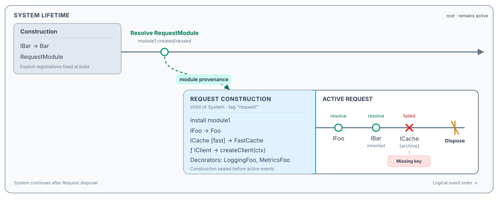

# Autofac Lifetime Composition DSL — Design Specification

**Status:** Implemented native PlantUML diagram · **Revision:** 1.1
**Diagram type:** `@startautofac` / `@endautofac`
**Target:** JVM SVG/PNG, browser TeaVM SVG, and headless TeaVM SVG. A diagram engine, **not an Autofac solver**.

## Implemented language contract

The implementation covers every MUST requirement and every non-pooled §10 scenario. Other SHOULD features and LATER items are not implicitly supported. Selection, outcomes, activation, sharing, ownership, object identity and dependency paths are **author-declared facts**, never predictions from registrations. Missing facts remain `unspecified`; an unannotated resolve is a neutral request, not a successful activation.

Wrap exactly one `composition "Title" { ... }` in `@startautofac` / `@endautofac`. Common PlantUML title, legend, scale and `<style>` commands work; place them outside the composition. An explicit `title` overrides the composition title.

- IDs match `[A-Za-z_][A-Za-z0-9_-]*`; `none` and `external` are reserved. Scope, module, event and object IDs have typed namespaces; ambiguous uses are errors.
- Newlines or `;` separate simple statements. Braced declarations can share a line. Strings support `\"`, `\\`, `\n`, `\t`; apostrophe and `//` begin comments outside strings. Types are opaque names or quoted labels with balanced generics, not C# expressions.
- `module M { ... }` contains `register`, `decorate`, `depends`. `lifetime rootId root { ... }` and `lifetime child from parent [tag "tag"] [ownedBy acquisition] { ... }` also permit `install`.
- Registration forms are `register id: SERVICE -> TYPE`, `register id: SERVICE instance objectId`, and `register id: SERVICE via delegate LABEL|{ call resolve SERVICE from scope ... }`. Optional `sharing single|perScope|transient|matching("tag")` and `ownership scope|external` are descriptive. Declare a pre-existing object with `instance id: TYPE [owner scope|external]`.
- `SERVICE` is `TYPE [key "key" | name "name"]`. Keys remain part of the service identity. Only registrations accept unquoted `key *`; a literal `"*"` remains a literal key.
- `decorate SERVICE with TYPE` preserves registration order. `depends TYPE { id: SERVICE [via ctor|property] ... }` describes dependencies within composition/module/lifetime; it does not create runtime events.
- `resolve id: SERVICE from scope` is a request. `call resolve id: SERVICE from scope during event` is an explicit runtime bridge. Anonymous calls inside delegate blocks are templates, never automatically executed.
- `invoke id: factory()` and `evaluate id: lazy.Value` are separate events referring to an earlier acquisition/object; optional `from scope` sets their origin. Otherwise they inherit the referenced operation's explicit origin. A pre-existing object needs an explicit origin.
- `install module1` asserts installation of a previously resolved module instance whose requested type names a module definition. Qualified registration references are `system.bar`, `request.foo`, or `request.module1.foo`. Contributions expand by default, retaining definition and installation provenance.
- `expect id success`, `expect id failure CATEGORY`, or `expect id recursion` optionally contain facts: `selected REF`, `activation scope`, `sharing scope|none`, `owner scope|external`, `instance objectId`, `state new|reused`, `category CATEGORY`, `path A -> B`, `cycle A -> B -> A`, `chain Outer -> Inner -> Base`, `cause LABEL`, `risk LABEL`, `message "text"`, `exception TYPE`, `confidence declared|derived|observed|uncertain`, `empty`, `tag "tag"`. Facts occur at most once; confidence defaults to `declared`. `derived` still means author-derived.
- Categories are `missingRegistration`, `missingKey`, `missingMatchingScope`, `disposedScope`, `activationFailure`, `disposalError`, `constructorCycle`, `propertyCycle`, `recursiveResolve`, `captiveDependency`, `scopeCreation`, `custom`. `expect scope failure scopeCreation` draws failed construction without an active track.
- `state new` introduces an explicitly named object; `state reused` requires an earlier causal introduction. `instance` without state leaves creation history unknown. No identity is manufactured from request aliases.
- Source order orders runtime events. `parallel { ... }` removes sibling order, including nested groups; the bounded unordered region does not claim concurrent C# execution. Parent/module/Owned prerequisites remain causal constraints. Definitions and expectations add no time.
- `dispose scope` or `dispose ownedAlias` explicitly ends a lifetime; no parent cascade is inferred. `dispose attempt: scope` permits `expect attempt failure disposalError`; that attempt leaves subsequent lifecycle unspecified until another terminal disposal.
- `Owned<T>` creates no implicit scope in the diagram. Explicit `lifetime worker from request ownedBy owned { }` anchors one child birth at the acquisition event; `dispose owned` closes that child.
- `view lifetimes` is default. `view diagnostics` adds declared problem panels; `expand id [trace]` adds detail panels in either view. No `focus`, other projections, simulation or interactive collapse is implemented.

Structural validation rejects duplicate/unknown/ambiguous references, impossible ordering, installation or reuse before its prerequisite, invalid placements and duplicate terminal disposals. Invalid scope use remains drawable with `notCreated` or `disposedScope` warnings. `undisposedChild` warns without inventing child disposal. If containment would falsify the timeline, aligned depth-indented lanes preserve independent ends and show ancestry.

Missing composition and unclosed composition are distinct errors. An unclosed block's message includes its opening source line, even after leading comments. For EOF-only errors, the structured error position still follows PlantUML's common factory; it need not equal that opener line.

Styles use normal `<style> autofacDiagram { ... } </style>` inheritance, including `autofacLifetime`, `autofacChildLifetime`, `autofacConstruction`, `autofacChildConstruction`, `autofacHeading`, `autofacMuted`, `autofacDetail`, `autofacResolve`, `autofacFailure`, `autofacDispose`, `autofacModule`, `autofacWarning`. Shape/text distinguishes outcomes without relying solely on color. SVG groups have stable `af-*` IDs and source locations.

Runnable examples and SVG references: [`baseline`](../src/test/resources/vega/autofac/baseline.puml), [`module outcomes`](../src/test/resources/vega/autofac/module-outcomes.puml), [`recursion`](../src/test/resources/vega/autofac/recursion.puml), [`independent ends / unordered events`](../src/test/resources/vega/autofac/orphan-parallel.puml).

Visual hierarchy follows the supplied reference: each rounded, closed lifetime envelope has a bold scope heading, a shaded **Construction** compartment and a separate **ACTIVE** track. Child construction uses a blue compartment within its parent lifetime. A track arrow plus `remains active` status denotes an unspecified end; a terminal cap denotes explicit disposal. The border is a containment frame, not the precise temporal endpoint.

Request markers have a short action above and the requested service/key below; generated disposal IDs and repeated DSL sentences are not displayed. Provenance curves stay in the local parent/child gap, with labelled badges. Dotted binding lookups use one legend key rather than repeated captions. Explicit/template calls have separate locally measured routing strips. Expanded detail cards show provided facts, retain unknowns as unspecified, and use measured shelf placement near their targets instead of an unbounded left-hand stack. Standalone SVGs paint their configured canvas background; intentionally transparent backgrounds remain transparent.

Structural lifecycle warnings are shown once through PlantUML's common warning banner, not repeated as detail cards. Unordered-region borders and titles reserve space around lifetime/phase headings and nested event rows; these regions do not change causal order or extend actual lifetime endpoints.

Implementation: `src/main/java/net/sourceforge/plantuml/autofac/`. Both native builders register the same factory and share the positioned parser, structural binder and measured `UGraphic` renderer. No Graphviz, .NET, AWT rendering dependency or delegate execution is used by the shared diagram code. New source remains Java 8-compatible; the repository's current OpenPDF dependency requires JDK 21 to build.

Native syntax keywords must remain disjoint from the bundled obfuscation replacement dictionary (`src/main/resources/net/sourceforge/plantuml/utils/words.txt`). In particular, `confidence` is reserved and excluded from that dictionary, preserving existing `--obfuscate` behavior for other diagram types.

After changing `src/main/resources/skin/plantuml.skin`, refresh TeaVM's checked-in skin from the existing generator before building JavaScript:

```sh
java -cp build/classes/java/main net.sourceforge.plantuml.teavm.EmbeddedResourcesGenerator
./gradlew test --tests 'net.sourceforge.plantuml.autofac.*' --tests 'test.vega.VegaTest' \
  jar teavm :plantuml-mcp-js:generateJavaScript -Pfast
```

Browser and headless TeaVM are separate compilations; both require runtime verification. Browser logical dimensions retain the engine's 8192-unit ceiling. The sections below provide design rationale and Autofac background; this implemented contract governs executable behavior.

### Autofac npm prerelease

Build with the existing Nix tooling and JDK 21:

```sh
./gradlew --offline :npmPackage -Pfast \
  -PnpmName=@peterder72/plantuml-core \
  -PnpmVersion=1.2026.7-autofac.1 \
  -PnpmTag=autofac \
  -PnpmRepository=https://github.com/peterder72/plantuml-extended
npm publish ./build/npm-plantuml --tag autofac --access public \
  --registry=https://registry.npmjs.org/
```

Push the source commit to `feature/autofac` before publishing. Do not create a Git release tag: this fork's CI has broad tag-creation triggers. The npm `autofac` dist-tag is independent of Git tags and must not move `latest` or `beta`. The generated package records its selected publishing tag in `publishConfig`, includes the GPL license, and links to this fork's source.

The browser bundle can be loaded directly or tested through the live editor's local package alias. For Vite production builds, preserve the generated TeaVM code with `build.minify: false`; re-minification has produced invalid JavaScript (`Undefined label`). The package README records this integration constraint.


## 1. Purpose

Produce diagrams that answer, visually and unambiguously:

1. Which **lifetime scopes** exist, which created which, and when are they disposed?
2. **What is registered when a scope is constructed**, including modules supplied to that scope?
3. Where did an installed **module instance** originate (including when it was resolved from an ancestor scope)?
4. From which scope was a service **requested**, which registration was **selected**, and—optionally—which object was returned and who owns it?
5. Why did resolution **succeed, fail, reuse an instance, or recurse**?

The primary drawing is a **lifetime diagram**, not a dependency graph. The original hand-drawn concept—horizontal system/child/request lifetimes—is preserved, but a **nested lifetime envelope** replaces ambiguous branching arrows. Resolutions are events attached to an envelope; dependency and resolution traces are optional drill-downs.

### Design invariants

- **Scope hierarchy is primary.** Runtime dependency chains must never dictate the main diagram topology.
- **Construction is a distinct phase.** Direct registrations and module installation occur as part of building the root or configuring `BeginLifetimeScope`, before the new scope is available for ordinary resolution.
- **Scope ≠ registration ≠ resolution ≠ instance.** These are different objects in the model.
- **Registration location ≠ instance owner in general.** Sharing and disposal rules determine ownership. A `perScope` service registered in System can be instantiated per Request; a System singleton belongs to System.
- **Scope lookup ≠ explicit cross-scope call.** Implicit ancestor registration search and user code calling another `ILifetimeScope.Resolve()` are different operations and require different graphical edges.
- **Normal documentation diagrams are explanatory, not executable simulations.** Results that depend on arbitrary C# delegate bodies need declarations, runtime observations, or uncertainty labels.

## 2. Requirements

Priorities: **MUST** = core; **SHOULD** = targeted design coverage; **LATER** = schema must permit extension, but UI support may wait.

### 2.1 Core scope and construction requirements

| ID | Priority | Requirement |
|---|---|---|
| L-01 | MUST | Represent a root/System lifetime, child lifetimes, sibling lifetimes, and arbitrary nesting. |
| L-02 | MUST | Represent scope creation, parent, optional tag/name, beginning, duration, and explicit disposal; allow scopes with no documented end. |
| L-03 | MUST | Display each scope's **construction compartment** before its active period. |
| L-04 | MUST | Attach direct registrations and installed modules **only to construction**. Never depict ordinary late registration on an already active scope. |
| L-05 | MUST | Define reusable modules and show the registrations/decorators they contribute. |
| L-06 | MUST | Resolve a module instance from one lifetime and install that instance into a newly created child lifetime; show its provenance separately from the child registration effect. |
| L-07 | MUST | Show resolution and disposal as chronologically ordered events without converting them into lifetime branches. |
| L-08 | MUST | Support incomplete ordering: if events have no known relative time, do not imply precise timing. |
| L-09 | SHOULD | Represent scopes created implicitly by Autofac relationships such as `Owned<T>`. |
| L-10 | SHOULD | Represent nested scopes that remain undisposed after parent disposal, and indicate invalid later use. |

### 2.2 Registration and selection requirements

| ID | Priority | Requirement |
|---|---|---|
| R-01 | MUST | Distinguish registration ID, exposed service type, implementation/activator, source scope/module, sharing policy, and ownership policy. |
| R-02 | MUST | Support constructor/type registrations, instance registrations, and lambda/delegate registrations. |
| R-03 | MUST | Support keyed/named registrations and keyed/unkeyed resolution requests. Keys are part of the service identity, not decorations on the instance type. |
| R-04 | MUST | Support decorators, their registration order, their wrapping order, and expanded decorator instance chains. |
| R-05 | MUST | Display authored ancestor selections and child overrides while preserving registration order; never choose a binding automatically. |
| R-06 | MUST | Display `single`, `perScope`, `transient`, and `matching(tag)` metadata; distinguish authored sharing from disposal ownership. |
| R-07 | SHOULD | Support `perOwned<T>`, external ownership, and disposal/release callbacks. |
| R-08 | SHOULD | Support multiple exposed service identities, `PreserveExistingDefaults`, conditional registrations, open generics, metadata, `AnyKey`, and collection resolution. |
| R-09 | SHOULD | Show implicit registration sources as construction-time providers whose results may be generated at lookup time. |
| R-10 | LATER | Support composite/adapter, pooled, tenant-specific, interceptor/proxy, and custom pipeline registrations. |

### 2.3 Resolution, instance, and diagnostic requirements

| ID | Priority | Requirement |
|---|---|---|
| E-01 | MUST | Show a resolve event with requested service/key, origin scope, optional selected registration, and result. |
| E-02 | MUST | Distinguish selected registration's declaring scope from the scope used for activation, the returned instance's sharing scope, and its disposal owner. |
| E-03 | MUST | Show success, new instance, reuse, missing registration/key, activation failure, and disposal errors. |
| E-04 | MUST | Show **explicit calls** to resolve from another named scope, especially calls made inside delegate registrations. |
| E-05 | MUST | Detect/annotate modeled recursive service-location loops without rendering infinitely repeated edges; distinguish *potential* recursion from confirmed runtime stack overflow. |
| E-06 | MUST | Expand a failed operation into a diagnostic path: request → chosen registration → activation/delegate → failing nested request or exception. |
| E-07 | SHOULD | Show missing matching lifetime tag, constructor cycles, supported property-injection cycles, and captive dependency warnings. |
| E-08 | SHOULD | Show deferred relationships (`Func<T>`, custom delegate factories, `Lazy<T>`) separately from later invocation/evaluation. |
| E-09 | SHOULD | Show `Owned<T>`-induced implicit child scopes, release, and disposal. |
| E-10 | SHOULD | Show activation callbacks, required-property injection, constructor parameters and selection, and middleware as optional stages. |
| E-11 | SHOULD | Allow outcomes to be marked as **declared**, **derived**, or **observed**. |
| E-12 | LATER | Support tracing imports, operation correlation, partial traces, actual duration, async disposal, and pooled lease/return events. |

### 2.4 Visualization and usability requirements

| ID | Priority | Requirement |
|---|---|---|
| V-01 | MUST | Use nested **lifetime envelopes** with a visually separate construction header and active timeline. |
| V-02 | MUST | Maintain consistent horizontal chronology and vertical containment; sibling envelopes must not imply parent-child relationships. |
| V-03 | MUST | Use distinct marker shapes for registrations, resolves, failures, and disposal. Color must not be the only differentiator. |
| V-04 | MUST | Keep registration provenance and decorator order legible without expanding a full dependency graph. |
| V-05 | MUST | Render explicit cross-scope calls distinctly from inherited lookup/visibility. |
| V-06 | SHOULD | Provide collapsible construction sections, compact registration summaries, focused scopes, and expanded resolution/failure panels. |
| V-07 | SHOULD | Offer projections (`lifetimes`, `registrations`, `instances`, `diagnostics`, `full`) over the **same** underlying composition. |
| V-08 | SHOULD | Stable semantic IDs; deterministic layout; textual legend; readable monochrome/print output. |

## 3. Domain model

### 3.1 Entities

| Entity | Responsibility | Core fields |
|---|---|---|
| `Composition` | Entire explanatory scenario | ID/title, scope tree, operations, presentation directives |
| `LifetimeScope` | A real Autofac lifetime scope | ID, parent, tag, birth/disposal events, construction contents, implicit/explicit origin |
| `ModuleDefinition` | Reusable bundle of configuration | ID, contributed registrations, decorators, sources, optional parameters |
| `ModuleInstance` | Specific module object used during child construction | ID, type, original resolve/creation event, source scope |
| `Registration` | Binding rule declared in a scope/module | ID, exposed services (type + key), activator, sharing, ownership, order, metadata |
| `RegistrationSource` | Provider of lookup-time derived bindings | ID, source kind, synthesis rule/description |
| `ResolveOperation` | A request for a service | ID, originating scope, requested service identity, arguments, nested calls, result |
| `Instance` | One real object, not one resolution | ID, registration, creation event, sharing scope (if any), disposal owner, state |
| `Event` | Ordered point or interval on scope's timeline | ID, kind, scope, partial-order constraints, optional timestamp |
| `Diagnostic` | Problem, warning, inference, or expected outcome | ID, severity, category, causal path, confidence/grounding |
| `Presentation` | Projection and expansion controls | View, focus, hidden groups, shown traces, scale |

**Do not merge** the following: registration declaration scope, starting scope of a resolve call, selected registration, scope used for component activation, instance sharing scope, and disposal owner.

### 3.2 Relationships

- **Containment:** lifetime parent → child; envelope nesting.
- **Registration provenance:** module or direct declaration → registration; construction-local only.
- **Module provenance:** ancestor-scope module resolution → module instance → child-scope construction.
- **Lookup:** resolution's origin context → selected registration in current/ancestor scope (or generated binding).
- **Explicit call:** delegate/middleware/factory → `Resolve` against a named scope; may cross the hierarchy in application code.
- **Dependency:** activation requests another service; belongs to an optional expanded resolution panel, *not* main scope layout.
- **Instance identity:** resolution result → existing or newly created instance.
- **Disposal ownership:** scope or external owner → instance; independent of lexical reference retention.

### 3.3 Phase model

Each lifetime has these conceptual phases:

`declared/configuring → active → disposing → disposed`

Configuration is atomic in the primary visualization: the construction header shows the *result* of the root build or `BeginLifetimeScope` configuration callback. If construction itself throws, mark a **failed scope creation** instead of showing a fully active child. Registration sources may synthesize bindings at lookup time; they do not imply mutating an ordinary built scope's explicit registration list.

## 4. DSL design

The DSL is declarative scenario notation, **not C#** and not an Autofac interpreter. Full sources require the native wrappers documented above; snippets below use their appropriate composition/construction context.

### 4.1 Primitive vocabulary

| Keyword | Purpose | Representative syntax |
|---|---|---|
| `composition` | Scenario boundary | `composition "Sample" { ... }` |
| `module` | Reusable construction contribution | `module RequestModule { ... }` |
| `lifetime` | Root or child scope and its construction | `lifetime request from system tag "request" { ... }` |
| `register` | Binding/activator in construction | `register foo: IFoo -> Foo sharing perScope` |
| `install` | Install an existing module instance at scope creation | `install module1` |
| `decorate` | Register decorator, preserving order | `decorate IFoo with LoggingFoo` |
| `resolve` | Request an object from an active scope | `resolve r1: IFoo from request` |
| `call resolve` | Explicit runtime bridge or delegate template | `call resolve nested: IFoo from request during outer` |
| `depends` | Explain constructor/property requirements | `depends Foo { bar: IBar }` |
| `invoke` | Invoke a deferred factory | `invoke w1: factory()` |
| `evaluate` | Trigger a lazy value | `evaluate w2: lazy.Value` |
| `dispose` | End scope lifetime | `dispose request` |
| `expect` | Expected identity, warning, or error | `expect r1 failure missingRegistration` |
| `view`, `expand`, `parallel` | Presentation and incomplete order | `view diagnostics; expand r1` |

#### Naming and references

- Stable names like `request`, `module1`, `r1`, `foo` are **diagram identifiers**; display labels are optional.
- A service identity is `(type, optional key)`, e.g. `ICache key "fast"`. Keys can eventually be typed expressions such as enums.
- A registration is a rule, not an instance; resolve aliases identify events, while explicit `instance` facts identify returned objects.
- Braces in `lifetime` and `module` contain construction declarations and descriptive `depends` blocks only. Runtime operations occur at composition level or inside `parallel`.
- `lifetime request from system` is a **scope creation event** at that point in the scenario; no later statements may modify its registration list.
- A delegate template may reference a later declared lifetime. This validates existence, not execution.
- `parallel { ... }` removes sibling-order edges; no actual duration is implied. `at`, `after` and `before` are not accepted.

### 4.2 Component registration forms

```text
register foo: IFoo -> Foo sharing perScope
register bar: IBar -> Bar sharing single
register worker: IWorker -> Worker sharing transient
register session: ISession -> Session sharing matching("request")
register ext: IClock instance clock1 ownership external
register client: IClient via delegate createClient(ctx) sharing transient
register cacheFast: ICache key "fast" -> FastCache sharing perScope
register cacheFallback: ICache key * -> GenericCache

decorate IFoo with LoggingFoo
decorate IFoo with MetricsFoo
```

`key *` describes an `AnyKey`-style registration; unkeyed resolution remains distinct. Sharing labels describe Autofac policies, but do not determine a diagram's selected binding, returned object, sharing scope or owner.

An explicit delegate block describes calls without inventing runtime executions:

```text
register foo: IFoo via delegate {
  call resolve IFoo from request
} sharing transient
```

This is intentionally different from resolving an Autofac-generated `Func<IFoo>` relationship.

### 4.3 Construct a child with a parent-resolved module

```text
composition "Module-provisioned request" {
  module RequestModule {
    register foo: IFoo -> Foo sharing perScope
    register cacheFast: ICache key "fast" -> FastCache
    register cacheSlow: ICache key "slow" -> SlowCache
    register client: IClient via delegate createClient(ctx)
    decorate IFoo with LoggingFoo
    decorate IFoo with MetricsFoo
  }

  lifetime system root {
    register bar: IBar -> Bar sharing single
    register moduleRegistration: RequestModule -> RequestModule sharing single
  }

  resolve module1: RequestModule from system

  lifetime request from system tag "request" {
    install module1
  }

  resolve foo1: IFoo from request
  resolve bar1: IBar from request
  resolve client1: IClient from request
  resolve fast1: ICache key "fast" from request
  resolve bad: ICache key "archive" from request
  expect bad failure missingRegistration

  dispose request
  view lifetimes
}
```

**Authored structure:** System builds first; `module1` is requested from System; installation explicitly asserts using that module object during Request construction. The ordinary requests remain unspecified. Only `bad` has a declared outcome: missing registration. That failure does not dispose Request. Use explicit `selected`, activation, sharing and owner facts to explain inherited `IBar`; the runnable module-outcomes fixture demonstrates these distinctions.

### 4.4 A simpler baseline case

```text
composition "Two lifetimes" {
  lifetime system root {
    register bar: IBar -> Bar sharing single
  }

  lifetime request from system {
    register foo: IFoo -> Foo sharing perScope
  }

  resolve r1: IFoo from request
  resolve r2: IBar from request
  dispose request
}
```

This is the smallest representative diagram: System exists, Request begins with its registration, two neutral requests appear, then Request ends explicitly. No dependency chain or predicted outcome is required.

## 5. Visualization specification

### 5.1 Primary projection: nested lifetime envelopes



- **Outer envelope:** closed System/root containment frame. A track arrow and `remains active` status show that disposal was not specified.
- **Nested envelope:** closed child/request frame with an explicit lifetime heading, parent/tag subtitle, shaded construction and active track.
- **Construction compartment:** shaded leading region of *each* scope, listing direct registrations and installed modules. It ends before the scope's active events.
- **Active track:** horizontal line carrying resolution/invocation/disposal markers.
- **Module provenance link:** labelled, curved dashed connection from System's module resolve event to the child envelope's top boundary above construction; this is *not* a child scope edge or an ordinary service dependency.
- **Registration provenance:** module-contributed entries are grouped under `install module1` (expandable); direct registration entries remain separate.
- **End cap:** a double-slash/terminal marker plus `Dispose` label ends the active track. The envelope retains visual padding; its border must not be interpreted as an additional lifecycle event.

**Horizontal coordinate:** causal/event order; not proportional elapsed time by default. **Vertical coordinate:** containment/hierarchy, not call depth. Siblings get separate non-overlapping bands. Child envelopes may be displayed inside an outer envelope or in aligned nested lanes where depth would make the interior illegible; the parent relationship must remain explicit.

### 5.2 Symbol legend

| Glyph / style | Element | Required text |
|---|---|---|
| Shaded compartment | Scope construction | Explicit Construction heading, registrations and sealed-phase footer |
| `T → Impl` | Type/constructor registration | Service and implementation |
| `ƒ T → delegate` | Delegate registration | Service and factory/body label |
| `T [key]` | Keyed registration or resolve | Requested type and key |
| `⊃ T with Decorator` | Decorator declaration | Service, decorator type, order |
| Hollow circle `○` | Resolve event | Requested service/key |
| Solid dot `●` | Successful activation/result | Instance alias or identity if expanded |
| Repeat arrow `↩` | Reused instance | Instance identity and sharing scope |
| Cross `×` | Failed resolve | Error summary/category |
| Thick curved loop | Recursion | Authored cycle participants and confidence |
| Dashed connector with badge | Explicit/template call or module provenance | Connection type labelled separately from phase headings |
| Faint dotted connector | Authored selected-binding lookup | One legend key; selected registration in expanded details |
| Terminal stroke `//` | Dispose scope | Scope identifier |
| Nested object boxes | Decorator instance chain (expanded) | Outer → inner order |

Colors are supplemental: construction = cool neutral, normal resolution = green/teal, warning = amber, failure/recursion = red. The glyph and label must remain sufficient in black-and-white output.

### 5.3 Presentation layers

1. **`view lifetimes` (default):** scope envelopes, expanded construction, resolve events, disposal and module provenance.
2. **`view diagnostics`:** the same chronological geometry plus panels for authored failures, cycles and diagnostic categories.

`expand foo1 trace` adds authored binding/instance/decorator/path detail in either view; it never replaces lifetime topology. `view registrations`, `view instances`, `view full`, focus and interactive collapsing are not implemented.

### 5.4 Decorator visualization

**During construction** show ordered declarations:

```text
IFoo → Foo
⊃ IFoo with LoggingFoo
⊃ IFoo with MetricsFoo
```

**When resolution is expanded**, show nesting rather than another lifetime:

```text
Resolve IFoo
└─ MetricsFoo #1  (outermost)
   └─ LoggingFoo #1
      └─ Foo #1    (base)
```

For Autofac's simplified decorator model, later decorator registrations wrap earlier ones. Their lifetime and ownership follow the decorated component; no new lifetime scope is created merely by decoration. This is different from a wrapper *with its own new lifetime* created by some unrelated mechanism.

### 5.5 Failures and recursion

- Failed marker belongs at the **originating resolve event**, even if the fault occurred in a nested dependency or cross-scope call.
- Error panel lists *request*, *selected registration*, *activation/delegate stage*, *cause*, and *exception type if known*.
- Failed resolves do not, by themselves, terminate the lifetime scope.
- Circular constructor dependencies, supported circular property injection, and recursive `ILifetimeScope.Resolve()` calls must have distinct categories.
- Infinite modeled loops are rendered as **one feedback arc**, not an infinite chain.

## 6. Autofac background for authors

These Autofac rules help authors explain their scenarios. The diagram engine does **not** execute them or derive outcomes from them:

1. **Visibility:** child scope resolutions can use local registrations and ancestor registrations. Ordinary lookup does not descend from parent into child.
2. **Override:** a local service registration may replace the inherited default. Multiple registrations, collection requests, ordering, and `PreserveExistingDefaults()` affect final selection.
3. **Ownership context:** a shared component (notably a singleton) is activated using its owning scope, so child overrides are not automatically injected into root-owned singleton dependencies.
4. **Sharing policy:** `transient` yields a new instance per service request; `perScope` shares within a lifetime; `matching(tag)` shares at the nearest appropriate matching ancestor; `single` shares for the declaring lifetime and its eligible descendants.
5. **Disposal:** a scope tracks owned disposable components it creates/resolves according to Autofac rules; externally owned objects are excluded. Parent disposal does not automatically dispose child scopes.
6. **Dynamic sources:** registered `IRegistrationSource` providers may produce bindings on lookup, while normal explicit registrations remain fixed after scope construction.
7. **Relationship types:** `IEnumerable<T>` may successfully resolve empty; `Func<T>` and `Lazy<T>` defer target acquisition; `Owned<T>` creates a child scope to be released explicitly.
8. **Failures:** absent keyed/unkeyed services, missing matching scope, disposed scope, unsupported constructor cycles, and delegate/constructor activation exceptions are different classes of failure.
9. **Observed vs declared:** arbitrary C# delegate bodies, middleware, reflection and mutable captured scopes cannot be interpreted by this language. Explicit confidence distinguishes declared, author-derived, observed and uncertain facts.

## 7. Critical worked scenarios

### 7.1 Delegate recursively resolves inherited registration

A System-level delegate registration calls `request.Resolve<IFoo>()` explicitly. Request has no local `IFoo` override. A request for `IFoo` in System activates the System delegate; that delegate asks Request; Request sees the same inherited System binding; the delegate is invoked again.

```text
composition "Recursive cross-scope resolve" {
  lifetime system root {
    register risky: IFoo via delegate {
      call resolve IFoo from request
    } sharing transient
  }
  lifetime request from system { }

  resolve trigger: IFoo from system
  call resolve again: IFoo from request during trigger
  expect trigger recursion {
    selected system.risky
    cycle risky -> request.IFoo -> risky
    risk stackOverflow
  }
  view diagnostics
}
```

**Graph:** the delegate template describes a call; `again` supplies an explicit runtime bridge. The authored selected binding and cycle produce one finite feedback arc. A stack-overflow risk is not an observed exception.

**Important:** This is a modeled possibility, not a guarantee about the exact terminal exception. A call that repeatedly starts new `Resolve()` operations is distinct from a constructor/constructor circular dependency that Autofac detects as unsupported. Do not assert that every circular chain ends in a stack overflow; runtime details and intervention may change the outcome.

A child override does not automatically change the diagram's outcome. Change the explicit selection/cycle facts to document a terminating path.

### 7.2 Missing keyed registration

```text
resolve bad: ICache key "archive" from request
expect bad failure missingRegistration
```

**Graph:** a crossed request marker and authored `missingRegistration` diagnostic. Adding an `AnyKey` registration alone does not rewrite an outcome.

### 7.3 Delegate activation fails after selection

```text
register client: IClient via delegate {
  call resolve IConnection from request
}
resolve client1: IClient from request
expect client1 failure activationFailure {
  path IClient -> delegate -> IConnection
  cause "missingRegistration(IConnection)"
}
```

**Graph:** failure marker at `Resolve IClient`, not a missing `IClient` registration. Expanded diagnostic points to missing `IConnection` during delegate activation.

### 7.4 Deferred factory and `Owned<T>`

```text
lifetime request from system { }
resolve factory: Func<IWorker> from request
invoke worker1: factory()
invoke worker2: factory()
resolve owned: Owned<IWorker> from request
lifetime workerScope from request ownedBy owned { }
dispose owned  // shorthand: release the owned scope
```

**Graph:** acquisition and factory invocations are distinct events. The explicitly bound child opens at the `Owned<IWorker>` acquisition and releasing the alias closes it. Bare `Owned<T>` creates no diagram scope. Explicit `instance` / `state` facts document new or reused workers; registration policy alone does not decide identity.

### 7.5 Singleton with child override

```text
lifetime system root {
  register logger: ILogger -> ConsoleLogger sharing single
  register service: IService -> Service sharing single
  depends Service { logger: ILogger }
}
lifetime request from system {
  register requestLogger: ILogger -> RequestLogger
}
resolve service1: IService from request
expect service1 success {
  selected system.service
  activation system
  sharing system
  owner system
  path Service -> system.logger
}
expand service1 trace
```

**Graph:** the author declares System selection, activation, sharing and ownership independently of Request origin. The dependency path explicitly names System's logger; it is not inferred from `depends`. A separate local logger request needs its own authored selection.

### 7.6 Circular property injection versus constructor cycle

Two separate diagnostic codes:

```text
cycle ctor A -> B -> A : unsupported
cycle property A <-> B : supported if sharing + PropertiesAutowired(AllowCircularDependencies) rules permit
```

This is a diagnostic shorthand, not the main composition grammar; expanded panels show the actual registrations and injection mechanism. The unsupported constructor cycle is expected to throw rather than be labeled an automatic stack overflow.

## 8. Validation and diagnostic language

The validator checks structural facts only; Autofac outcomes remain authored:

- Duplicate scope/event/registration IDs; unknown references or parent IDs; invalid lifetime ancestry.
- Registration/module installation outside a lifetime's construction compartment.
- Resolving a service from a scope before creation or after its disposal.
- Installing a module instance before it exists; circular module-provenance dependencies.
- Disposal ordering and orphaned child scopes (warning, because parent disposal does not cascade).
- Impossible event-order cycles.
- Qualified selected references must exist, but their visibility/precedence is not solved.
- Dependency cycles, missing matching tags, captive dependencies and recursive resolves require explicit outcome/path annotations.

A diagnostic carries:

```text
Diagnostic {
  severity: error | warning | info
  category: missingRegistration | missingKey | missingMatchingScope |
            disposedScope | activationFailure | constructorCycle |
            recursiveResolve | captiveDependency | custom
  originEvent: <resolve-id>
  path: [<stage-or-registration>...]
  confidence: declared | derived | observed | uncertain
  message: "..."
}
```

**No static interpretation of delegates or container configuration.** Anonymous `call` templates are descriptive; named calls represent authored runtime events. Diagnostic outcomes are supplied explicitly.

## 9. Native rendering architecture

```text
DSL text
  ↓ parse + name binding
Scenario model (scopes, construction, events, registrations)
  ↓ structural references + causal validation
Bound authored model (explicit identities, paths, outcomes, warnings)
  ↓ projection selection
Lifetime-envelope layout (scope rows, birth/death x-coordinates)
  ↓ overlays
Registrations / module provenance / resolve markers / errors
  ↓
SVG or another renderer-specific output
```

Separation is deliberate:

- **Parser model:** what the author explicitly described.
- **Bound model:** located typed references, causal order and structural lifecycle warnings; no container solver.
- **Outcome facts:** explicit declarations, observations and confidence; no automatic trace import.
- **Presentation model:** measured lifetime geometry over those values, retaining canonical IDs.

The shared native `UGraphic` renderer exports JVM SVG/PNG, browser TeaVM SVG and headless TeaVM SVG. It uses the runtime's supplied text metrics and no Graphviz process.

### Layout algorithm sketch

1. Assign each lifetime a vertical band nested under its parent; allocate sibling bands by stable declaration order.
2. Establish an x-order from creation, resolve, module-installation prerequisites, factory invocations, and disposal constraints.
3. Render distinct lifetime, construction and active headings; keep registrations in the shaded construction compartment anchored at birth.
4. Center action/service/detail labels around active-track markers and measure separate parallel subtracks without changing causal order.
5. Route provenance through the local parent/child gap, above child headings; reserve local call strips below phase headings rather than a global overhead routing area.
6. Place titled failure/instance/decorator detail cards in measured shelves near their targets, showing supplied facts without repeated unknown rows.
7. When events are only partially ordered, group/label them as unordered; avoid fabricated elapsed durations.

## 10. Acceptance scenarios / test matrix

| Case | What must be shown |
|---|---|
| Root + request + two resolves + disposal | Nested request envelope; local construction; two resolve markers; terminal cap |
| System module installed in Request | System module resolve event, module instance ID, provenance connector into Request construction |
| System `IBar` resolved in Request | Origin Request; selected System registration; no false child registration |
| Child overrides System service | Local binding selected in Request; System binding still selectable in System |
| Root singleton with child dependency override | Reused System-owned instance and System-resolved dependency |
| Two keyed registrations | Distinct `(type,key)` identities, key on both declaration and resolution |
| Missing key | `×` on originating event, `missingRegistration` diagnostic, scope remains active |
| Delegate throws after matching registration | `activationFailure`, not `missingRegistration` for outer requested service |
| Two ordered decorators | Two declarations in construction; correct outer-to-inner instance nesting |
| Explicit cross-scope recursive delegate | Labeled bridge and single feedback loop; bounded visualization |
| Constructor circular dependency | Error trace, distinct from recursive `ILifetimeScope.Resolve()` |
| Supported property circular dependency | Cycle with success, not automatic error |
| `Owned<T>` | Explicitly bound nested scope with acquisition-aligned birth and own end/disposal |
| `Func<T>` | Acquisition event separate from invocation events |
| `Lazy<T>` | Evaluation event distinct from wrapper resolution |
| `IEnumerable<T>` empty | Successful empty collection, not missing-registration error |
| Missing matching tag | Scope-selection failure with expected tag shown |
| Parent disposed before child | Separate scope ends and lifecycle warning; no fictitious cascade |
| Pooled instance reused across requests | Lease/return and stable object identity across distinct request envelopes (later) |

## 11. Deliberate non-goals

No Autofac simulator, C# execution, runtime instrumentation/import, pooled leases, actual durations, automatic instance identities, implicit Owned scopes, unsupported projection aliases, interactive collapsing or generic dependency-graph-first layout. Modules expand by default; lifetime envelopes are physically nested unless independent ends or invalid-use events require explicit ancestry lanes.

## 12. Autofac documentation references

Semantics above are based on the official Autofac 9.0 documentation; the proposed DSL itself is an original design, not an Autofac API.

- [Scope hierarchy, dependency lookup, and parent/child disposal](https://docs.autofac.org/en/latest/lifetime/index.html)
- [Instance sharing policies and matching scopes](https://docs.autofac.org/en/latest/lifetime/instance-scope.html)
- [Registration order and conditional registrations](https://docs.autofac.org/en/latest/register/registration.html)
- [Adding registrations when constructing child scopes](https://docs.autofac.org/en/latest/faq/update-container.html)
- [Named/keyed services, `IIndex`, and `AnyKey`](https://docs.autofac.org/en/latest/advanced/keyed-services.html)
- [Adapters and decorators](https://docs.autofac.org/en/latest/advanced/adapters-decorators.html)
- [Implicit relationship types](https://docs.autofac.org/en/latest/resolve/relationships.html)
- [Owned instances](https://docs.autofac.org/en/latest/advanced/owned-instances.html)
- [Circular dependencies](https://docs.autofac.org/en/latest/advanced/circular-dependencies.html)
- [Delegate factories](https://docs.autofac.org/en/latest/advanced/delegate-factories.html)
- [Registration sources](https://docs.autofac.org/en/latest/advanced/registration-sources.html)
- [Resolution tracing and diagnostic hooks](https://docs.autofac.org/en/latest/troubleshooting/tracing.html)

---

**Summary:** Model a tree of *lifetime envelopes*, each with a sealed **construction compartment** and an **active event track**. Overlay module provenance, registration selection, instance identity, cross-scope calls, and diagnostic loops on demand. Never allow resolution/dependency graphs to displace lifetime hierarchy as the primary visualization.
